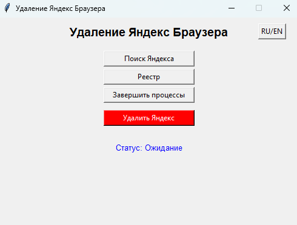
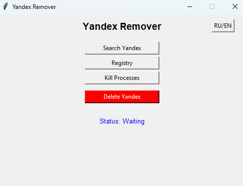

[**RU**]

**Хочу сразу же отметить что это моя первая утилита, так что надеюсь что это программа будет вам полезна**

Инструкция:
1. Скачайте последнию версию из **GitHub**
2. Откройте программу
3. Закройте процесс Яндекса в программе ( кнопка "**Завершить процессы**" )
4. Нажмите кнопку "**Поиск Яндекс**"
5. Если Яндекс Браузер найден нажмите на "**Удалить Яндекс**" ( хочу сразу же отметить что даже если вылезла ошибка то **возможно** получилось удалить браузер )
6. После удачного удаление Яндекс Браузера можете спокойно закрывать программу
( Желательно еще раз нажать на кнопку "**Поиск Яндекс**" )

Если вы заметили ошибку или хотели бы помочь с программой можете написать об этом либо в **GitHub** или на мою почту **vos80584@gmail.com**

**Спасибо что выбрали мою программу**

[**EN**]

**I want to immediately note that this is my first utility, so I hope that this program will be useful to you**

Instructions:
1. Download the latest version in **GitHub**
2. Open the program
3. Close the Yandex process in the program (the "**Kill Processes**" button)
4. Click the button "**Search Yandex**"
5. If Yandex Browser is found, click on "**Delete Yandex**" (I want to immediately note that even if an error occurs, it is **possible** to delete the browser)
6. After successfully deleting Yandex Browser, you can safely close the program
(It is advisable to click the "**Search Yandex**" button again)

If you notice an error or would like to help with the program, you can write about it either in **GitHub** or to my email **vos80584@gmail.com**

**Thank you for choosing my program**
